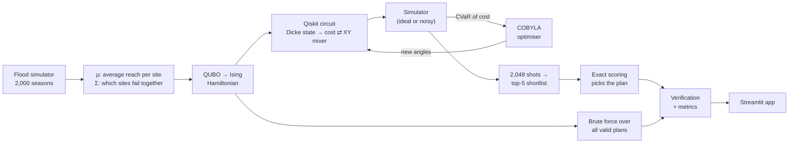

<div align="center">

# 🌊 Quantum Relief

### Where should relief supplies be stored *before* the flood, so one flood cannot cut them all off?

A constraint-preserving quantum optimiser (QAOA in Qiskit) that picks warehouse sites by trading **people reached** against **flood risk**, with an app a relief planner can use without knowing any physics.


[**Run it**](#-run-it-in-2-minutes) · [**The idea**](#-the-idea-in-30-seconds) · [**How it works**](#-how-it-works) · [**Results**](#-results) · [**Limits**](#-honest-limitations) · [**Report**](docs/REPORT.md) · [**Pitch**](docs/PITCH.md)


</div>

---

## 💡 The idea in 30 seconds

A relief agency can afford to stock **4 of 10** candidate warehouses before monsoon season. The obvious plan is to stock the four sites that reach the most people. But those sites sit in the same two river basins, and **sites in one basin get cut off together**.

So we optimise two competing goals at once:

| Plan | People reached, typical year | People reached, bad flood year | River basins used |
|---|---:|---:|:---:|
| Biggest sites (greedy) | **274,700** | 90,000 | 2 |
| **Quantum plan** (balanced) | 255,500 | **136,000** | **4** |

Giving up 7% of typical-year reach protects **51% more people in a bad year**. The quantum plan is identical to the brute-force optimum over all 210 possible plans.

> "Bad flood year" = the 1-in-20 worst season across 20,000 simulated seasons the optimiser never saw. All demo data is synthetic.

## 🚀 Run it in 2 minutes

```bash
git clone <this-repo-url>
cd <repo-folder>
python -m venv .venv
```

<details open>
<summary><b>Windows (PowerShell)</b></summary>

```powershell
.venv\Scripts\python -m pip install -r requirements.txt
.venv\Scripts\python -m streamlit run app.py
```
Use `py -m venv .venv` if `python` is not recognised.
</details>

<details>
<summary><b>macOS / Linux</b></summary>

```bash
.venv/bin/python -m pip install -r requirements.txt
.venv/bin/python -m streamlit run app.py
```
</details>

The app opens at `http://localhost:8501`. Then try:

| Do this | See this |
|---|---|
| Drag **"How cautious should the plan be?"** to the left, press the button | The plan collapses onto the biggest sites in two basins |
| Drag it right | Stock spreads across basins; bad-year reach rises |
| Open **Flood outlook**, raise one basin to 80% | The plan moves stock out of that basin |
| Open the **Under the hood** tab | Qubits, gates, measured distribution, noise simulation |

<details>
<summary><b>Reproduce every number and figure</b></summary>

```bash
python -m pytest -q              # 8 tests, incl. Hamiltonian = cost on all 1,024 bitstrings
python -m src.run_baseline       # exact + greedy reference table
python -m src.run_experiments    # all figures and results/results.json (about 2 minutes)
```
Everything is seeded. `notebooks/demo.ipynb` walks through the same steps with outputs saved.
</details>

## ⚙️ How it works



**Formulation.** One binary variable per site, $x_i = 1$ if site $i$ is stocked:

$$\max_x \;\; \underbrace{\mu^\top x}_{\text{expected people reached}} \;-\; \lambda\,\underbrace{x^\top \Sigma\, x}_{\text{variance across flood seasons}} \qquad \text{s.t.}\;\; \sum_i x_i = K$$

$\Sigma$ is the covariance of people reached between sites. Two sites in the same basin have a large positive $\Sigma_{ij}$, so choosing both is penalised. $\lambda$ is the app's caution slider.

**Why quantum fits.** Substituting $x_i = (1 - Z_i)/2$ turns each $\Sigma_{ij}$ into a two-qubit $Z_iZ_j$ interaction and each $\mu_i$ into a single-qubit $Z_i$ term. One site is one qubit; there are no slack or helper qubits.

<details>
<summary><b>The three circuits we compare</b></summary>

| Variant | Start state | Mixer | Budget rule $\sum x_i = K$ |
|---|---|---|---|
| Standard QAOA | all $2^n$ bitstrings | X rotations | soft penalty in the cost |
| **Dicke + XY mixer** | only the $\binom{n}{K}$ valid plans | XX+YY ring | **built into the circuit**, cannot be broken |
| **+ CVaR** | same | same | same; trained on the best 10% of outcomes |

- **Dicke state**: deterministic Bärtschi–Eidenbenz construction, implemented gate by gate in [`src/qaoa.py`](src/qaoa.py) and unit-checked against the exact state.
- **XY mixer**: each gate partially swaps a chosen and an unchosen site, so the number of chosen sites is conserved.
- **Training**: depth grows one layer at a time; each depth starts from the interpolated optimum of the previous one (INTERP).
- **Answer extraction**: the 5 most-measured plans form a shortlist, which is scored exactly by a classical check.
</details>

<details>
<summary><b>Repository map</b></summary>

| Path | What it does |
|---|---|
| [`app.py`](app.py) | The planner app |
| [`src/instance.py`](src/instance.py) | Sites, basins and the flood-season simulator |
| [`src/formulation.py`](src/formulation.py) | Objective → QUBO → Ising Hamiltonian |
| [`src/baseline.py`](src/baseline.py) | Brute-force optimum and greedy plan |
| [`src/qaoa.py`](src/qaoa.py) | Dicke state, mixers, training, ideal and noisy sampling |
| [`src/evaluate.py`](src/evaluate.py) | Approximation ratio, P(optimum), shortlist |
| [`src/run_experiments.py`](src/run_experiments.py) | Regenerates `results/` |
| [`tests/`](tests) | Formulation checks and an end-to-end app test |
| [`docs/`](docs) | Brief report and 3-minute pitch script |
</details>

## 📊 Results

Test instance: 10 sites, 4 to stock, 210 valid plans, $\lambda = 0.005$. Exact reference: brute force.

**1. Building the budget into the circuit beats penalising it.**


| Variant (p = 3 layers) | Valid shots | Approximation ratio | P(exact optimum) | vs. random guess |
|---|---:|---:|---:|---:|
| Standard QAOA (penalty) | 88% | 0.63 | 0.4% | 0.9× |
| Dicke + XY mixer | **100%** | **0.83** | 4.9% | 10× |
| Dicke + XY mixer + CVaR | **100%** | 0.80 | **10.0%** | **21×** |

**2. The quantum pick matches the exact optimum at every caution level.**


Across six values of $\lambda$ the quantum pick was the rank-1 plan of 210 every time.

<details>
<summary><b>3. What the circuit actually outputs</b></summary>


The exact optimum is the single most-measured plan, about 20 times more often than a random valid plan.
</details>

<details>
<summary><b>4. What hardware noise does (and why this is not hardware-ready)</b></summary>


| Two-qubit gate error | Valid shots | P(exact optimum) |
|---|---:|---:|
| 0 (ideal) | 100% | 9.5% |
| 0.1% | 70% | 6.5% |
| 0.3% | 40% | 2.5% |
| 1% | 25% | 0.4% |

The p = 3 circuit compiles to 574 CX gates. Noise breaks the budget guarantee, so invalid shots must be discarded.
</details>

## 🧭 Honest limitations

- **No quantum speed-up is shown or claimed.** With 10 sites, brute force takes milliseconds. This is a correct small-scale formulation, not evidence of advantage.
- **Simulator only.** At today's error rates most shots would violate the budget (table above).
- **Synthetic data.** Capacities and flood odds are invented to be plausible; site names are real places.
- **Variance is a blunt risk measure.** It penalises good surprises as much as bad ones.
- **Shortlist caveat.** With only 210 valid plans, sampling alone would eventually hit the optimum, so we report how strongly the circuit *concentrates* probability rather than whether the optimum appears.
- **Novelty.** We found classical mean-variance relief models but no quantum implementation of this problem in a brief literature search; that search was not exhaustive.

## 🎯 Where each judging criterion is answered

<details>
<summary><b>Open the rubric map</b></summary>

| Criterion | Where to look |
|---|---|
| A. Problem validity | [The idea](#-the-idea-in-30-seconds), formulation above, [report §1–2](docs/REPORT.md) |
| B. Meaningful quantum utilisation | [`src/qaoa.py`](src/qaoa.py), variant table above, [report §3](docs/REPORT.md) |
| C. Implementation and validation | `pytest`, [`src/run_experiments.py`](src/run_experiments.py), [Results](#-results) |
| D. Innovation | Correlated-flood risk as the quadratic term; hand-built Dicke + XY ansatz with CVaR |
| E. Presentation | The app, [pitch script](docs/PITCH.md) |
</details>

## ☁️ Put the app online (optional, free)

1. Push this repository to GitHub.
2. Sign in at [share.streamlit.io](https://share.streamlit.io) with GitHub and choose **Create app**.
3. Select this repository, branch `main`, main file `app.py`, then **Deploy**.

## 📚 References

- Farhi, Goldstone, Gutmann. *A Quantum Approximate Optimization Algorithm* (2014).
- Hadfield et al. *From the Quantum Approximate Optimization Algorithm to a Quantum Alternating Operator Ansatz* (2019).
- Bärtschi, Eidenbenz. *Deterministic Preparation of Dicke States* (2019).
- Barkoutsos et al. *Improving Variational Quantum Optimization using CVaR* (2020).
- Zhou et al. *QAOA: Performance, Mechanism, and Implementation on Near-Term Devices* (2020).
- Nagurney, Nagurney. *A Mean-Variance Disaster Relief Supply Chain Network Model for Risk Reduction* (2016).
