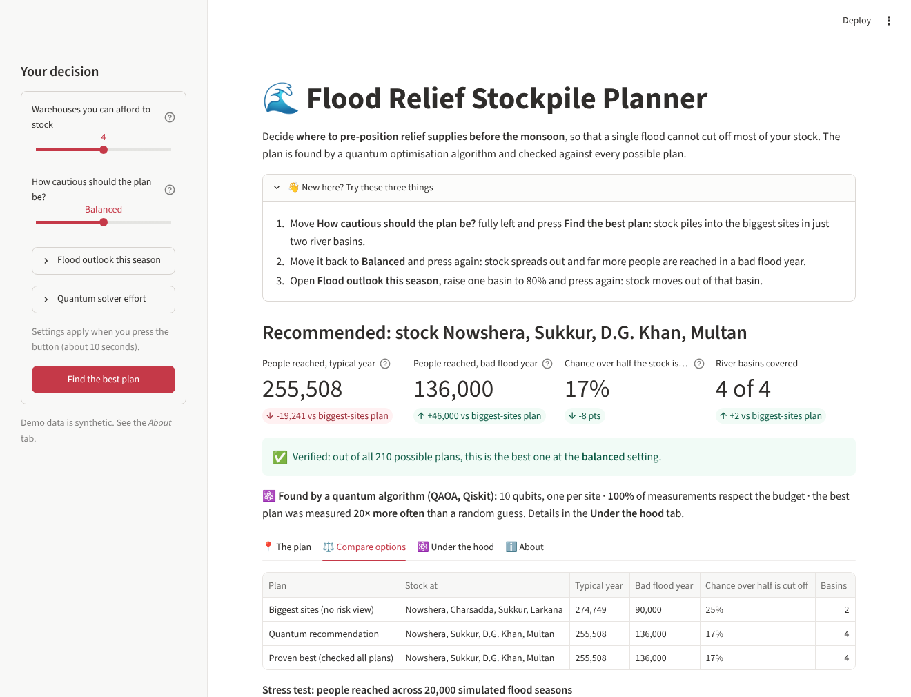
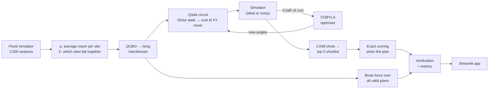
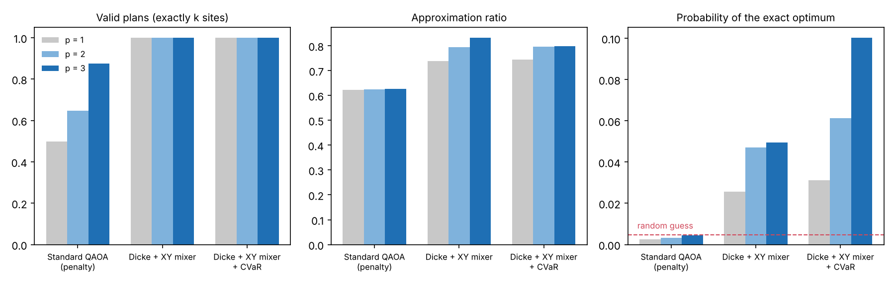
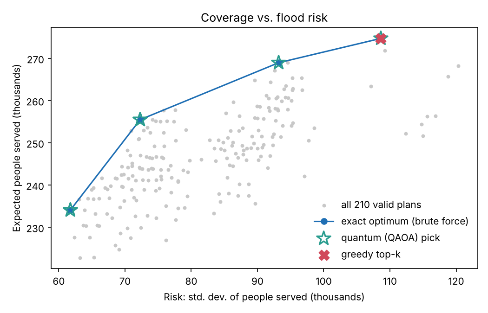
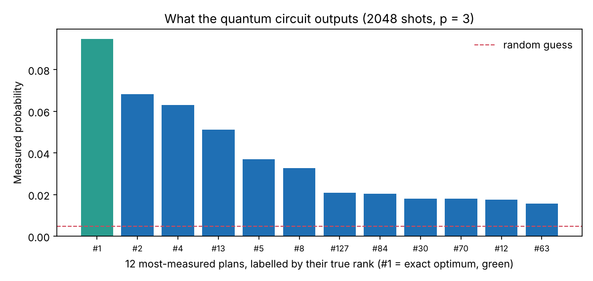
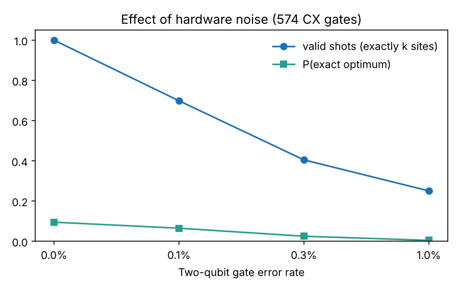

<a name="top"></a>
<div align="center">

# 🌊 Quantum Relief

### Where should relief supplies be stored *before* the flood, so one flood cannot cut them all off?

A constraint-preserving quantum optimiser (QAOA in Qiskit) that picks warehouse sites by trading **people reached** against **flood risk**, with an app a relief planner can use without knowing any physics.


[](https://hackathon-project1.streamlit.app/)


### 🌐 [Open the live app — no install needed](https://hackathon-project1.streamlit.app/)

| [🚀 Run the app](#-run-the-app) | [🧪 Run the code](#-run-the-code) | [💡 The idea](#-the-idea-in-30-seconds) | [🔧 How it works](#-how-it-works) | [📊 Results](#-results) | [🧭 Limits](#-honest-limitations) |
|:-:|:-:|:-:|:-:|:-:|:-:|

📄 [Report (.docx)](docs/REPORT.docx) · 📓 [Notebook walkthrough](notebooks/demo.ipynb)



</div>

---

## 💡 The idea in 30 seconds

A relief agency can afford to stock **4 of 10** candidate warehouses before monsoon season. The obvious plan is to stock the four sites that reach the most people. But those sites sit in the same two river basins, and **sites in one basin get cut off together**.

So we optimise two competing goals at once:

| Plan | People reached, typical year | People reached, bad flood year | River basins used |
|---|---:|---:|:---:|
| Biggest sites (greedy) | **274,700** | 90,000 | 2 |
| **Quantum plan** (balanced) | 255,500 | **136,000** | **4** |

Giving up 7% of typical-year reach protects **51% more people in a bad year**. The quantum plan is identical to the brute-force optimum over all 210 possible plans.

> "Bad flood year" = the 1-in-20 worst season across 20,000 simulated seasons the optimiser never saw. All demo data is synthetic.

<p align="right"><a href="#top">⬆ back to top</a></p>

## 🚀 Run the app

### Step 1 · Open the live app

<div align="center">

## 👉 [hackathon-project1.streamlit.app](https://hackathon-project1.streamlit.app/)

</div>

Nothing to install. It runs in any browser, including on a phone. If you see a "waking up" screen, wait about a minute. The first plan takes about 10 seconds.

| ✅ You should see | |
|---|---|
| Title | **Flood Relief Stockpile Planner** |
| Recommendation | *Recommended: stock Nowshera, Sukkur, D.G. Khan, Multan* |
| Green banner | *Verified: out of all 210 possible plans, this is the best one* |


### Step 2 · Try these three things

| # | Do this in the left panel | What happens |
|:-:|---|---|
| 1 | Drag **How cautious should the plan be?** fully left → **Find the best plan** | Stock piles into the biggest sites, in only two river basins |
| 2 | Drag it back to **Balanced** → **Find the best plan** | Stock spreads over four basins; bad-year reach rises from 90,000 to 136,000 |
| 3 | Open **Flood outlook this season**, raise one basin to 80% → **Find the best plan** | Stock moves out of that basin |

Then open the **⚛️ Under the hood** tab for the qubits, gate counts, measured distribution and a hardware-noise simulation.

<details>
<summary><b>💻 Prefer to run it on your own computer?</b></summary>

> **On Windows it is one double-click:** download the project, open the folder and double-click **`run_app.bat`**. It creates the environment, installs everything and opens the app.

**You need:** Python 3.12 or newer (tested on 3.13) and Git. Nothing else: no quantum hardware and no accounts.

**1 · Get the code**

```bash
git clone https://github.com/abdulrehman11tariq/Qiskit.git
cd Qiskit
```

**2 · Install and start**

🪟 **Windows**

Double-click `run_app.bat`, **or** run in PowerShell:

```powershell
py -m venv .venv
.venv\Scripts\python -m pip install -r requirements.txt
.venv\Scripts\python -m streamlit run app.py
```

🍎 **macOS** / 🐧 **Linux**

```bash
python3 -m venv .venv
.venv/bin/python -m pip install -r requirements.txt
.venv/bin/python -m streamlit run app.py
```

**3 · Open it**

The app opens in your browser automatically, on your own machine. The first plan takes about 10 seconds.

Stop the app with <kbd>Ctrl</kbd> + <kbd>C</kbd> in the terminal.


**Something not working?**

| Symptom | Fix |
|---|---|
| `Python was not found` (Windows) | Use `py` instead of `python`. If `py` is missing too: `winget install Python.Python.3.13`, then reopen the terminal |
| Streamlit asks for an email on first start | Press <kbd>Enter</kbd> to skip |
| `Activate.ps1 cannot be loaded` | Not needed. The commands above call `.venv\Scripts\python` directly |
| `Port 8501 is already in use` | Add `--server.port 8502` to the last command |
| Browser does not open | Copy the `Local URL` printed in the terminal into your browser |
| Install fails on an old Python | Check `python --version`; 3.12+ is required |

</details>

<p align="right"><a href="#top">⬆ back to top</a></p>

## 🧪 Run the code

These run on your own computer: first do the install under **Prefer to run it on your own computer?** above, then run each command from the project folder. On macOS/Linux use `.venv/bin/python` in place of `.venv\Scripts\python`. Everything is seeded, so you get the same numbers we report.

| # | What it checks | Command | Time | You should see |
|:-:|---|---|:-:|---|
| 1 | The maths and the app are correct | `.venv\Scripts\python -m pytest -q` | ~15 s | `8 passed` |
| 2 | Exact and greedy reference plans | `.venv\Scripts\python -m src.run_baseline` | ~2 s | A table of plans; greedy reaches 274.7k, exact at λ = 0.005 reaches 255.5k |
| 3 | Every quantum experiment and figure | `.venv\Scripts\python -m src.run_experiments` | a few min | Three result blocks, then `saved figures and results.json in results/` |
| 4 | Step-by-step walkthrough | `.venv\Scripts\python -m jupyter notebook notebooks/demo.ipynb` | — | A notebook with outputs already saved |

<details>
<summary><b>What the 8 tests cover</b></summary>

- The Ising Hamiltonian equals the classical cost on **all 1,024 bitstrings**, with and without the penalty term.
- The penalty is zero exactly on valid plans.
- The Dicke-state circuit gives equal amplitudes on exactly-K bitstrings and zero elsewhere, for five sizes.
- The XY mixer never changes the number of selected sites.
- CVaR equals the mean of the best tail.
- Brute force respects the budget and is never worse than greedy.
- The app renders end to end and recommends a plan.
</details>

<details>
<summary><b>Use the solver from your own Python</b></summary>

```python
from src.instance import make_instance
from src.qaoa import run_qaoa, sample_counts
from src.evaluate import problem, metrics, counts_to_probs
from src.formulation import index_to_bits

inst = make_instance()                                   # 10 sites, stock 4
result = run_qaoa(inst.mu, inst.sigma, lam=0.005, k=inst.k,
                  method="xy", p=3, objective="cvar")    # train the circuit
probs = counts_to_probs(sample_counts(result), inst.n)   # measure 2,048 shots
m = metrics(probs, problem(inst.mu, inst.sigma, 0.005, inst.k))
plan = index_to_bits(m["pick"], inst.n)
print([name for name, chosen in zip(inst.names, plan) if chosen], "rank", m["pick_rank"])
```
</details>

<p align="right"><a href="#top">⬆ back to top</a></p>

## 🔧 How it works



**Formulation.** One binary variable per site, $x_i = 1$ if site $i$ is stocked:

$$\max_x \;\; \underbrace{\mu^\top x}_{\text{expected people reached}} \;-\; \lambda\,\underbrace{x^\top \Sigma\, x}_{\text{variance across flood seasons}} \qquad \text{s.t.}\;\; \sum_i x_i = K$$

$\Sigma$ is the covariance of people reached between sites. Two sites in the same basin have a large positive $\Sigma_{ij}$, so choosing both is penalised. $\lambda$ is the app's caution slider.

**Why quantum fits.** Substituting $x_i = (1 - Z_i)/2$ turns each $\Sigma_{ij}$ into a two-qubit $Z_iZ_j$ interaction and each $\mu_i$ into a single-qubit $Z_i$ term. One site is one qubit; there are no slack or helper qubits.

<details>
<summary><b>The three circuits we compare</b></summary>

| Variant | Start state | Mixer | Budget rule $\sum x_i = K$ |
|---|---|---|---|
| Standard QAOA | all $2^n$ bitstrings | X rotations | soft penalty in the cost |
| **Dicke + XY mixer** | only the $\binom{n}{K}$ valid plans | XX+YY ring | **built into the circuit**, cannot be broken |
| **+ CVaR** | same | same | same; trained on the best 10% of outcomes |

- **Dicke state**: deterministic Bärtschi–Eidenbenz construction, implemented gate by gate in [`src/qaoa.py`](src/qaoa.py) and unit-checked against the exact state.
- **XY mixer**: each gate partially swaps a chosen and an unchosen site, so the number of chosen sites is conserved.
- **Training**: depth grows one layer at a time; each depth starts from the interpolated optimum of the previous one (INTERP).
- **Answer extraction**: the 5 most-measured plans form a shortlist, which is scored exactly by a classical check.
</details>

<details>
<summary><b>Repository map</b></summary>

| Path | What it does |
|---|---|
| [`app.py`](app.py) | The planner app |
| [`src/instance.py`](src/instance.py) | Sites, basins and the flood-season simulator |
| [`src/formulation.py`](src/formulation.py) | Objective → QUBO → Ising Hamiltonian |
| [`src/baseline.py`](src/baseline.py) | Brute-force optimum and greedy plan |
| [`src/qaoa.py`](src/qaoa.py) | Dicke state, mixers, training, ideal and noisy sampling |
| [`src/evaluate.py`](src/evaluate.py) | Approximation ratio, P(optimum), shortlist |
| [`src/service.py`](src/service.py), [`src/worker.py`](src/worker.py) | Solver entry points and the helper process the app runs them in |
| [`src/run_experiments.py`](src/run_experiments.py) | Regenerates `results/` |
| [`tests/`](tests) | Formulation checks and an end-to-end app test |
| [`docs/`](docs) | Report (`REPORT.docx`, with architecture diagram) and a Markdown copy |
</details>

<p align="right"><a href="#top">⬆ back to top</a></p>

## 📊 Results

Test instance: 10 sites, 4 to stock, 210 valid plans, $\lambda = 0.005$. Exact reference: brute force.

**1. Building the budget into the circuit beats penalising it.**



| Variant (p = 3 layers) | Valid shots | Approximation ratio | P(exact optimum) | vs. random guess |
|---|---:|---:|---:|---:|
| Standard QAOA (penalty) | 88% | 0.63 | 0.4% | 0.9× |
| Dicke + XY mixer | **100%** | **0.83** | 4.9% | 10× |
| Dicke + XY mixer + CVaR | **100%** | 0.80 | **10.0%** | **21×** |

**2. The quantum pick matches the exact optimum at every caution level.**



Across six values of $\lambda$ the quantum pick was the rank-1 plan of 210 every time.

<details>
<summary><b>3. What the circuit actually outputs</b></summary>



The exact optimum is the single most-measured plan, about 20 times more often than a random valid plan.
</details>

<details>
<summary><b>4. What hardware noise does (and why this is not hardware-ready)</b></summary>



| Two-qubit gate error | Valid shots | P(exact optimum) |
|---|---:|---:|
| 0 (ideal) | 100% | 9.5% |
| 0.1% | 70% | 6.5% |
| 0.3% | 40% | 2.5% |
| 1% | 25% | 0.4% |

The p = 3 circuit compiles to 574 CX gates. Noise breaks the budget guarantee, so invalid shots must be discarded.
</details>

<p align="right"><a href="#top">⬆ back to top</a></p>

## 🧭 Honest limitations

- **No quantum speed-up is shown or claimed.** With 10 sites, brute force takes milliseconds. This is a correct small-scale formulation, not evidence of advantage.
- **Simulator only.** At today's error rates most shots would violate the budget (table above).
- **Synthetic data.** Capacities and flood odds are invented to be plausible; site names are real places.
- **Variance is a blunt risk measure.** It penalises good surprises as much as bad ones.
- **Shortlist caveat.** With only 210 valid plans, sampling alone would eventually hit the optimum, so we report how strongly the circuit *concentrates* probability rather than whether the optimum appears.
- **Novelty.** We found classical mean-variance relief models but no quantum implementation of this problem in a brief literature search; that search was not exhaustive.

## 📚 References

- Farhi, Goldstone, Gutmann. *A Quantum Approximate Optimization Algorithm* (2014).
- Hadfield et al. *From the Quantum Approximate Optimization Algorithm to a Quantum Alternating Operator Ansatz* (2019).
- Bärtschi, Eidenbenz. *Deterministic Preparation of Dicke States* (2019).
- Barkoutsos et al. *Improving Variational Quantum Optimization using CVaR* (2020).
- Zhou et al. *QAOA: Performance, Mechanism, and Implementation on Near-Term Devices* (2020).
- Nagurney, Nagurney. *A Mean-Variance Disaster Relief Supply Chain Network Model for Risk Reduction* (2016).
