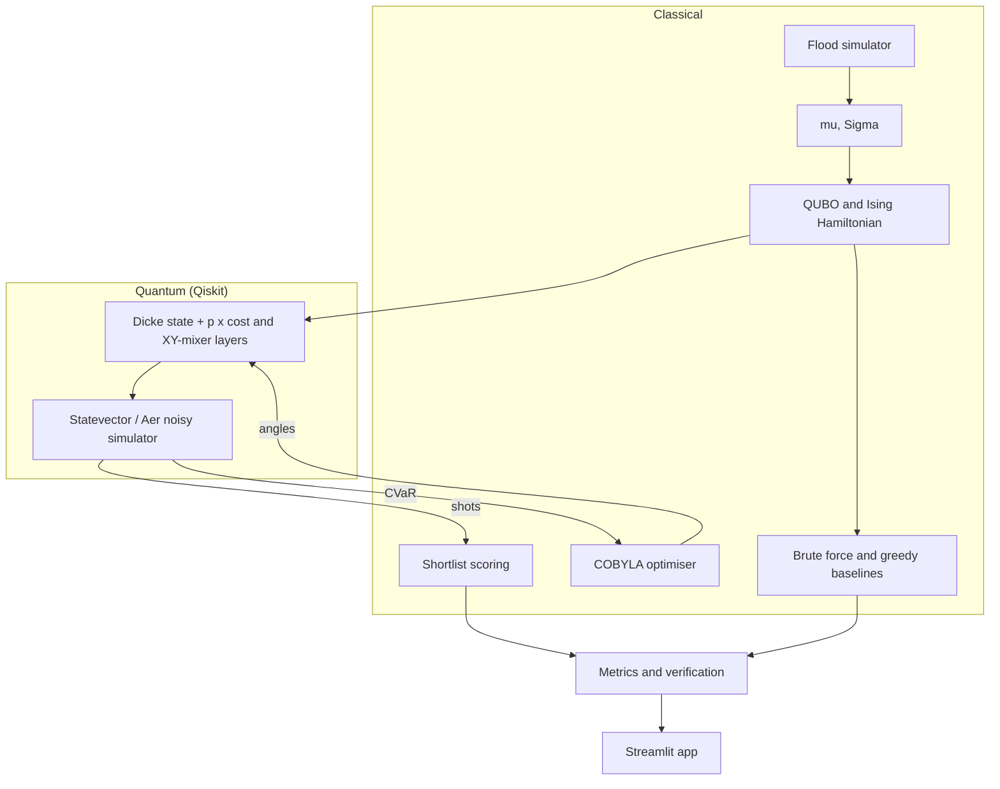

# Quantum Relief — Brief Report

## 1. Problem statement

**Context.** Before monsoon season a disaster-management authority pre-positions relief stock (food, tents, medicine) in a few warehouses. Budget covers K of N candidate sites.

**Motivation.** Sites close to large populations are usually in the same river basins, and a severe flood cuts off every site in a basin at once. Choosing sites one by one on expected reach therefore concentrates stock exactly where it is most likely to be lost together.

**Users.** Provincial and national relief planners deciding where to stock before the season.

**Objective and constraint.** Maximise expected people reached minus λ times the variance of people reached, subject to stocking exactly K sites.

## 2. Formulation

| Element | Definition |
|---|---|
| Decision variables | $x_i \in \{0,1\}$, 1 if site $i$ is stocked ($i = 1..N$) |
| Data | 2,000 simulated seasons → $\mu_i$ (mean people reached by site $i$), $\Sigma_{ij}$ (covariance) |
| Objective | minimise $C(x) = -\mu^\top x + \lambda\, x^\top \Sigma x$ |
| Constraint | $\sum_i x_i = K$ |
| Test instance | $N = 10$ sites in 4 river basins, $K = 4$, 210 valid plans, $\lambda = 0.005$ |

**Scenario model.** Each season, each basin floods severely with a fixed probability (25–35%). A site in a flooded basin is cut off with probability 0.25–0.85; otherwise with probability 0.03. A cut-off site reaches nobody.

**Quantum representation.** With $x_i = (1 - Z_i)/2$ the cost becomes an Ising Hamiltonian $H = \sum_i h_i Z_i + \sum_{i<j} J_{ij} Z_i Z_j$ on $N$ qubits. Coefficients are divided by the largest QUBO entry so they are O(1). A unit test confirms $\langle z|H|z\rangle + \text{offset} = C(x)$ on all 1,024 bitstrings.

## 3. Algorithm and justification

We use QAOA because the cost is natively quadratic in binary variables, which is the structure QAOA's cost layer implements exactly with one RZZ gate per pair.

The cardinality constraint is handled in the circuit rather than by a penalty:

- **Initial state:** Dicke state $|D^N_K\rangle$, the uniform superposition of all valid plans, prepared with the deterministic Bärtschi–Eidenbenz circuit (no ancillas).
- **Mixer:** a ring of $e^{-i\beta(XX+YY)/2}$ gates, which conserve the number of ones.
- **Objective:** CVaR at α = 0.10, which rewards concentrating probability on the best outcomes rather than improving the average.
- **Optimiser:** COBYLA; depth-1 from a coarse grid, deeper circuits warm-started by interpolation.
- **Read-out:** 2,048 shots; the five most-measured plans are scored exactly and the best is returned.

A standard penalty-based QAOA is implemented as the quantum reference.

**Assumptions.** Ideal gates for the main results; all-to-all ZZ connectivity (real devices need SWAP routing); statevector simulation for training.

## 4. Architecture

## 5. Results against the exact reference

Reference: brute force over all 210 valid plans.

| Variant | p | Valid shots | Approx. ratio | P(optimum) |
|---|:-:|---:|---:|---:|
| Standard QAOA (penalty) | 1 / 2 / 3 | 50% / 65% / 88% | 0.62 / 0.62 / 0.63 | 0.2% / 0.3% / 0.4% |
| Dicke + XY | 1 / 2 / 3 | 100% | 0.74 / 0.80 / 0.83 | 2.6% / 4.7% / 4.9% |
| Dicke + XY + CVaR | 1 / 2 / 3 | 100% | 0.74 / 0.80 / 0.80 | 3.1% / 6.1% / 10.0% |

A random valid plan is optimal with probability 0.48%. Approximation ratio is (worst − mean) / (worst − best) over valid plans.

**Decision quality.** For λ ∈ {0, 0.002, 0.005, 0.01, 0.02, 0.05} the quantum pick equals the exact optimum in all six cases.

| Plan | Expected reach | Std. dev. | Bad-year reach (5th pct.) |
|---|---:|---:|---:|
| Greedy top-4 | 274.7k | 108.6k | 90k |
| Quantum = exact, λ = 0.005 | 255.5k | 72.3k | 136k |
| Quantum = exact, λ = 0.02 | 234.1k | 61.7k | 126k |

Bad-year reach is measured on 20,000 fresh seasons.

**Noise.** The p = 3 circuit compiles to 574 CX gates. With depolarising CX error of 0.1% / 0.3% / 1%, valid shots fall to 70% / 40% / 25% and P(optimum) to 6.5% / 2.5% / 0.4%.

## 6. Reflection

- **Correctness.** Hamiltonian, Dicke state and weight conservation are each verified numerically; every app run is checked against brute force.
- **Feasibility.** Qubits scale one-for-one with sites, but the Dicke preparation and dense ZZ layer make the circuit too deep for current hardware.
- **Trade-offs observed.** CVaR doubles P(optimum) at p = 3 but slightly lowers the average-case ratio (0.80 vs 0.83). The penalty method gains valid shots with depth without gaining solution quality.
- **Limitations.** No speed-up at this size; synthetic data; variance penalises upside; λ = 0.02 is worse than λ = 0.005 in bad-year reach, showing variance and tail risk are not the same thing.
- **Next steps.** CVaR of people reached as the risk term, real flood records, hardware-native Dicke preparation, error mitigation by symmetry post-selection.
